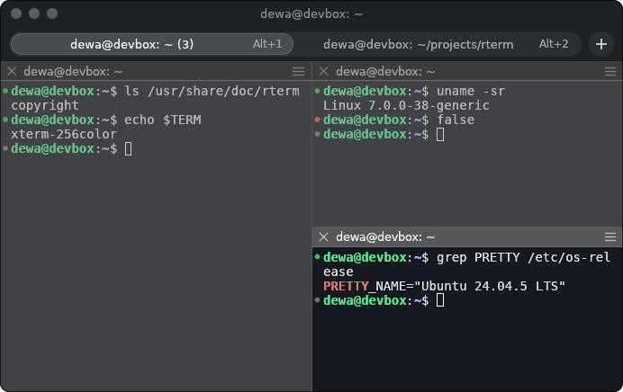

<p align="center">
  
</p>

<h1 align="center">rterm</h1>

<p align="center">
  An iTerm2-inspired terminal emulator for Linux, written in Rust.<br>
  Tabs, split panes, shell integration, find, autocomplete from scrollback, and a Settings window.
</p>

<p align="center">
  <a href="https://github.com/dewa55/rterm/actions/workflows/ci.yml"></a>
  <a href="https://github.com/dewa55/rterm/releases/latest"></a>
  <a href="LICENSE"></a>
</p>

<p align="center">
  
</p>

Built on [`alacritty_terminal`](https://crates.io/crates/alacritty_terminal) (terminal emulation),
[`portable-pty`](https://crates.io/crates/portable-pty) (PTY) and
[`egui`/`eframe`](https://github.com/emilk/egui) (UI: OpenGL, Wayland and X11).

> rterm is a personal project and not affiliated with iTerm2.

## Install

Download the `.deb` for your architecture (`amd64` or `arm64`) from the
[latest release](https://github.com/dewa55/rterm/releases/latest) and install it with apt, which
also pulls in the dependencies:

```bash
sudo apt install ./rterm_*_amd64.deb
```

Packages are built on Ubuntu 22.04 and work on Ubuntu 22.04 or newer and Debian 12 or newer.
rterm then shows up in Activities; `sudo apt remove rterm` uninstalls it.

To build from source instead, see [Build](#build).

## Look

The default appearance follows iTerm2 3.6/3.7 on macOS Tahoe:

- A title bar with traffic-light buttons. Drag it to move the window, double-click to maximize.
  Window edges resize it.
- Rounded window corners, with dark and light themes (`auto` follows the desktop).
- A capsule tab bar: tabs stretch to fill it, the active tab is a raised pill, each tab shows its
  shortcut, and a round `+` button sits at the end. A close button appears on hover, and a blue dot
  marks a background tab that rang the bell. The bar is hidden while only one tab is open, as in
  iTerm2, unless several windows are open (so every tab can be dragged to another window).
- Per-pane title bars on split panes (close button, title, ☰ menu), 1px dividers, and inactive
  panes dimmed toward grey.
- iTerm2's default **Regular** color preset (background `#15191f`, selection `#b3d7ff`).
- The terminal font comes from fontconfig (`monospace` by default) and the UI font from
  `sans-serif`.

Set `decorations = "system"` for the native GNOME title bar instead.

## Features

- **Tabs and split panes**, nested in any combination. Drag a divider to resize; maximize a single
  pane with Ctrl+Shift+Enter.
- **Multiple windows in one process** (Ctrl+Shift+N). Tabs can be:
  - reordered by dragging them along the tab bar, or with Ctrl+Shift+PageUp / PageDown
  - dragged out of the window to open in a window of their own, or dropped on another rterm window
    to move there
  - renamed by double-clicking them, with Ctrl+Shift+I, or from the tab's right-click menu
    (an empty title goes back to the automatic one)
  - colored from the right-click menu, which also has Move Tab to New Window, Move Tab to Window,
    Merge All Windows, Close Tabs to the Right and Close Other Tabs, as in iTerm2.
    Merge All Windows is also in the terminal's right-click menu.

  Closing the first window while others are open keeps the app running: that window takes over
  the tabs of another one. On Wayland, where windows can't see each other's positions, a tab
  dropped outside its window joins the rterm window the pointer is over when the button is
  released, and otherwise opens a new window wherever the compositor places it.
- **Shell integration** compatible with iTerm2/FinalTerm escape codes:
  - Prompt marks in the gutter: grey = prompt, blue = running, green = exit 0, red = failed
  - Jump to the previous/next prompt
  - New tabs and splits open in the active pane's directory, falling back to `/proc/<pid>/cwd`
    when the shell has no integration or reports a remote host
- **Mouse reporting** for vim (`mouse=a`), htop, tmux, mc and similar programs: X10, SGR (1006)
  and UTF-8 (1005) encodings; click, drag and any-motion tracking; and the wheel. Hold **Shift** to
  select text anyway.
- **Selection**: drag, Alt+drag for a rectangle, double click for a word, triple click for a line.
  The selection is copied when you release the mouse (`copy_on_select`).
- **Find** (Ctrl+Shift+F): a floating find bar like iTerm2's that searches the whole scrollback of
  the active pane:
  - Matches are highlighted yellow, the current match looks selected, and a `k/N` counter shows
    your position.
  - Marks on the right edge show where matches are in the buffer.
  - Smart case by default, with Aa for case-sensitive and .* for regex.
  - Enter steps to the previous (older) match and Shift+Enter to the next; F3 / Shift+F3 work too.
    Esc closes the bar.
- **Autocomplete** (Ctrl+;), like iTerm2's Cmd+;:
  - Completes the word before the cursor with words already in the pane's screen and scrollback,
    nearest first. This covers things the shell can't complete, such as pod names, container IDs,
    commit hashes, paths, URLs and IP addresses.
  - Keep typing to narrow the list. Up/Down choose, Enter or Tab inserts, Esc closes.
  - Smart case: lowercase input matches any case.
- **Links**: Ctrl+hover underlines a URL or an OSC 8 hyperlink, and Ctrl+click opens it.
- **Right-click menu**: Copy, Paste, Find, Split, Maximize Pane, New Tab, New Window, Clear Buffer,
  Close.
  Middle-click pastes.
- Bracketed paste, synchronized updates, xterm-256color and truecolor, OSC 52 copy.

## Keybindings

iTerm2's Cmd shortcuts are mapped to Ctrl+Shift so plain Ctrl keys keep reaching the shell.
All of them can be changed under `[keys]` in the config.

| Action | Keys |
|---|---|
| New tab | Ctrl+Shift+T |
| New window | Ctrl+Shift+N |
| Edit tab title | Ctrl+Shift+I |
| Move tab left / right | Ctrl+Shift+PageUp / Ctrl+Shift+PageDown |
| Close pane (closes the tab with its last pane) | Ctrl+Shift+W |
| Split vertically (side by side) / horizontally (stacked) | Ctrl+Shift+D / Ctrl+Shift+E |
| Maximize / restore the active pane | Ctrl+Shift+Enter |
| Move focus between panes | Ctrl+Alt+Arrows |
| Next / previous tab | Ctrl+PageDown / Ctrl+PageUp, Ctrl+Tab / Ctrl+Shift+Tab |
| Go to tab 1–9 | Alt+1 … Alt+9 |
| Previous / next prompt | Ctrl+Shift+Up / Ctrl+Shift+Down |
| Scroll a page, or to top / bottom | Shift+PageUp / Shift+PageDown, Shift+Home / Shift+End |
| Copy / paste | Ctrl+Shift+C / Ctrl+Shift+V |
| Find / next / previous | Ctrl+Shift+F, then Enter (up) / Shift+Enter (down); F3 / Shift+F3 |
| Autocomplete from scrollback | Ctrl+; |
| Clear buffer | Ctrl+Shift+K |
| Font size | Ctrl+= / Ctrl+- / Ctrl+0 |
| Settings | Ctrl+, |

## Settings

Open the Settings window with **Ctrl+,** or from the right-click menu (**Settings…**). Like
iTerm2's, it has four pages:

- **General**: shell, shell integration, copy on select, mouse reporting, and the config file location
- **Appearance**: theme, window style, corner radius, tab bar, pane title bars, dimming, and the
  default window size
- **Profiles**:
  - Text: font family (from installed monospace fonts), size, line spacing, bold, cursor style,
    with a live preview
  - Colors: color presets, importing `.itermcolors` files, and every color, including the 16 ANSI
    colors
  - Terminal: scrollback
- **Keys**: every action and its shortcut. Click a shortcut, press the new combination
  (Esc cancels, Backspace removes it), or use Restore Defaults.

Changes apply immediately and are saved to `config.toml`, keeping its comments.

## Configuration file

`~/.config/rterm/config.toml` is created on first run from
[`config.example.toml`](config.example.toml), which documents every option. rterm reloads the file
when you save it. Errors appear in a corner notice and the last good settings stay in effect.

Highlights:

```toml
[font]
family = "JetBrains Mono"     # any fc-match name, or a path to a .ttf/.otf
size = 14.0

[window]
theme = "auto"                # auto | dark | light
decorations = "iterm"         # iterm | system

[colors]
# Any .itermcolors file (e.g. from iTerm2-Color-Schemes), or a multi-preset plist:
itermcolors = "~/Downloads/Dracula.itermcolors"
preset = "Solarized Dark"

[keys]
"ctrl+shift+y" = "new_tab"
"alt+1" = "none"              # give Alt+1 back to the shell
```

## Shell integration

On startup rterm writes its scripts to `~/.local/share/rterm/shell` and injects them into new shells:

- **bash**: started as `bash --rcfile …/rterm-bashrc`. That file sources `~/.bashrc` first, then
  `rterm.bash`, which uses `PROMPT_COMMAND` and `PS0`.
- **zsh**: `ZDOTDIR` points at a shim `.zshenv`. The shim restores your `ZDOTDIR`, sources your
  `.zshenv`, and adds `precmd`/`preexec` hooks.
- **fish** 4.x emits OSC 133 and OSC 7 by itself.

Turn it off with `terminal.shell_integration = false`, or `RTERM_NO_SHELL_INTEGRATION=1`. For
remote hosts, copy `shell/rterm.bash` or `shell/rterm.zsh` there and source it from your rc file.
iTerm2's own `iterm2_shell_integration.*` scripts also work.

## Build

The build runs in a container, so the host needs no Rust toolchain. It works with any runtime that
supports the Docker CLI: Docker Engine, Podman, or Rancher Desktop.

```bash
./build.sh            # release build -> target/release/rterm
./build.sh test       # unit tests
./build.sh check      # any cargo subcommand
```

The image is `rust:1-bookworm`, whose glibc is older than current Ubuntu's, so the binary runs on
the host. The cargo cache lives in `~/.cache/rterm-cargo`.

## Install from source as a desktop app

Without a package, you can install your own build for the current user:

```bash
./build.sh && ./install.sh     # ./install.sh --uninstall to remove
```

This links `~/.local/bin/rterm` to the build output, so later rebuilds are picked up without
reinstalling. It also installs the icon into `~/.local/share/icons/hicolor` and adds
`~/.local/share/applications/rterm.desktop`. Search for **rterm** in Activities, or right-click it
in the dock and choose **Pin to Dash**. The icon is drawn by `assets/make_icon.py`
(`python3 -I assets/make_icon.py assets`).

## UI automation (development)

`RTERM_SCRIPT` drives the live window to reproduce a scenario and capture it. Steps are separated
by `;;` and can be:

- actions, using the names from `[keys]` (use the `autocomplete` action rather than `key ctrl+;`,
  because `;;` separates steps)
- `type <text>` (sent to the shell; `\n` = Enter), `text <text>` (keyboard input for focused fields),
  `key <combo>`
- `settings-page <name>`, `screenshot-settings <file.png>`
- `sleep <s>`
- `click|shift-click <x> <y> [right|middle]`, `press`/`release`/`move <x> <y>`, `wheel <lines>`
- `screenshot <file.png>`
- `quit`

```bash
RTERM_SCRIPT='sleep 1;;type ls\n;;split_vertical;;sleep 1;;screenshot /tmp/rterm.png;;quit' \
  xvfb-run -a env -u WAYLAND_DISPLAY ./target/release/rterm
```

Running under `xvfb-run` keeps test windows off your desktop. It also avoids stalls: GNOME stops
painting windows that open behind others. `RTERM_EMBED_VIEWPORTS=1` draws the Settings window
inside the main one so it can be captured too. `screenshot` captures only the first window, and
synthetic mouse input goes to it; to see other windows, grab the whole Xvfb screen (for example
with Pillow's `ImageGrab.grab()`). Scripted actions apply to the most recently focused window.

## Missing compared to iTerm2

Roughly in order of how much they are missed day to day:

**Everyday workflow**
- **Profiles**: there is a single profile. iTerm2 lets each tab or pane use its own profile, with
  its own font, colors and command (for example an "ssh prod" profile), and switch automatically
  by host or directory.
- **Session restore and window arrangements**: tabs and splits are not saved or restored after a
  restart.
- **Hotkey window**: no system-wide drop-down terminal (Wayland requires a desktop-specific
  global-shortcut portal).
- **Copy mode**: no keyboard-driven, vi-style selection.
- **Smart selection and semantic history**: quad-click for paths and URLs, and Ctrl+click on
  `file:line` to open an editor. Only URLs and OSC 8 links work now.
- **Paste history** (iTerm2's Cmd+Shift+H).
- **Notifications**: no desktop notification when a long command finishes or the bell rings, and
  no visual or audible bell.
- **Confirm before closing** a pane that is running a program, and **undo close tab**.
- **Native full screen** (F11) and a background opacity/blur option.

**Power features**
- **Triggers**: regex rules that highlight, notify or run a command when output matches.
- **tmux integration** (`tmux -CC`, tmux windows as native tabs).
- **Inline images**: the iTerm2 image protocol (`imgcat`), Sixel and Kitty graphics.
- **Broadcast input** to several panes, **coprocesses**, and **session logging** to a file.
- **Instant Replay**: stepping back through earlier screen states.
- **Status bar** components (git branch, CPU, host, and so on) and **badges**.
- **Shell integration extras**: command history and recent directories per host, select the
  output of the last command, alert on the next prompt, and `it2ul`/`it2dl` upload and download.
- **Scripting API**: iTerm2 has a Python API. rterm only has the development `RTERM_SCRIPT`.
- Password manager, AI chat and the built-in browser from recent iTerm2 releases.

**Text rendering and input**
- No italic font face, ligatures, cursor blink or cursor guide, and no minimum-contrast option.
- No IME or preedit input (CJK input methods) and no screen-reader accessibility.
- Not benchmarked against iTerm2's Metal renderer: egui lays out text every frame, so very
  large, fast output may be slower.

**rterm-specific issues**
- After the scrollback fills up, prompt marks drift, because `alacritty_terminal` does not report
  how many lines were rotated out.
- The zsh integration is untested. bash is tested.
- Rounded corners need a compositor with transparency, which GNOME and KDE both provide. Switching
  from `system` to `iterm` decorations needs a restart.
- Only `.deb` packages so far: no AppImage, Flatpak or apt repository.

## Releases and versioning

rterm uses [Semantic Versioning](https://semver.org). Versions are driven by
[Conventional Commits](https://www.conventionalcommits.org) on `main`, using
[release-please](https://github.com/googleapis/release-please):

| Commit message | Version bump (while 0.x) | Version bump (from 1.0) |
|---|---|---|
| `fix: ...` | patch: 0.1.0 → 0.1.1 | patch |
| `feat: ...` | minor: 0.1.0 → 0.2.0 | minor |
| `feat!: ...` or a `BREAKING CHANGE:` footer | minor | major |
| `docs:`, `chore:`, `ci:`, `refactor:`, `test:` | none | none |

1. Every push to `main` updates an open **release PR** that bumps the version in `Cargo.toml` and
   `Cargo.lock` and writes `CHANGELOG.md`.
2. Merging that PR tags `vX.Y.Z` and publishes a GitHub release.
3. The release workflow then builds `amd64` and `arm64` `.deb` packages and attaches them, with
   SHA-256 checksums.

## CI

GitHub Actions runs on every pull request and push to `main`, on free GitHub-hosted runners:

- [`ci.yml`](.github/workflows/ci.yml): `cargo fmt --check`, `cargo clippy -D warnings`,
  `cargo test`, then builds the `.deb` for `amd64` and `arm64` and uploads it as a workflow artifact.
- [`release.yml`](.github/workflows/release.yml): release-please, and the release packages.

Run the same checks locally in a container:

```bash
./build.sh fmt --check
./build.sh clippy --all-targets -- -D warnings
./build.sh test
```

## License

[MIT](LICENSE)
